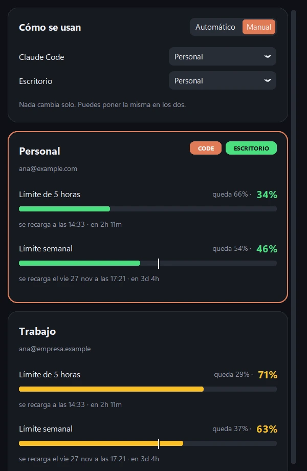

# Claude Usage

Small Windows desktop app (Python) that shows how much of your Claude Code limits you have used, without opening the browser.

- Bars for the 5-hour and weekly limits, with the time left until they reset.
- Tray icon with the current percentage, and Windows notifications.
- Settings, plugins and account management from the window, with no terminal.
- Updates are verified against the published SHA-256 before installing.
- Logs errors and account changes; never tokens or conversations.

Download it from [Releases](https://github.com/Serberar/claude-usage/releases/latest). Tests: `python tests.py`.

More details in the [Spanish README](README.md). [MIT](LICENSE) license.
