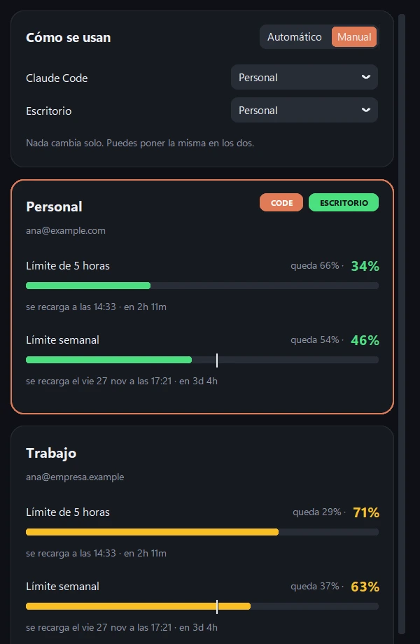

# Claude Usage

**Español** · [English](README.en.md)

[](https://github.com/Serberar/claude-usage/actions/workflows/tests.yml) [](https://github.com/Serberar/claude-usage/releases/latest)

Pequeña app de escritorio para Windows que muestra el consumo de tus cuentas de Claude Code sin tener que abrir el navegador.

<p align="center"></p>

Lee las cuentas que gestionas con [claude-swap](https://github.com/realiti4/claude-swap) (`cswap`) y para cada una enseña:

- **Límite de 5 horas** y **límite semanal**: barras que se van llenando con el consumo (verde → amarillo → naranja → rojo).
- Cuándo se recarga cada límite y cuánto falta.
- En la barra semanal, una raya con lo que deberías llevar gastado para llegar justo al reinicio.
- **Cómo se usan**, arriba: en **Automático**, Claude Code y la app de escritorio van con la misma cuenta y pasan solos a la otra cuando se agota; en **Manual**, eliges en dos desplegables la cuenta de Claude Code y la del escritorio (la misma o distintas) y nada cambia solo. Cada tarjeta marca dónde se usa esa cuenta (CODE, ESCRITORIO).
- Si la sesión de Claude Code de una cuenta caduca (o va a caducar en menos de 3 días), un botón **Iniciar sesión**: sale una ventana con el enlace para copiarlo y abrirlo en una ventana privada (así no se cuela la cuenta que tengas abierta en claude.ai) y un campo para pegar el código. Claude Code sigue con la cuenta que tenías.
- **La app de escritorio de Claude**: al pasarla a otra cuenta se cierra y se vuelve a abrir con la sesión de esa cuenta (la primera vez hay que iniciar sesión en ella y a partir de ahí se guarda). El consumo que apunta la app de escritorio se usa cuando cswap no puede leerlo.

Además deja un **icono junto al reloj** con el % consumido de la cuenta activa, del color que toque. Con doble clic se abre la ventana y con clic derecho puedes actualizar, cambiar de cuenta o salir.

Las cuentas se detectan solas: si añades o quitas una con `cswap`, aparece o desaparece en menos de un minuto.

Todo se maneja desde la propia ventana, sin terminal:

- **Plugins**: las herramientas para gastar menos tokens que tienes instaladas. La app recomienda dos, [token-diet](https://github.com/Serberar/token-diet) y [RTK](https://github.com/rtk-ai/rtk), cada una con lo bueno y lo malo, si afecta a la calidad del código y cuánto ahorra. También enseña los plugins de Claude Code que hayas instalado por fuera. Se activan y desactivan con un botón, y se actualizan cuando hay una versión nueva. Una barra estima cuánto te ahorras con las que tienes activas.
- **Ajustes** (cada parte se despliega por separado):
  - **Tus cuentas**: si falta Claude Code o claude-swap, la app los descarga e instala. Desde ahí guardas la cuenta actual, añades otra (se abre el inicio de sesión de Claude), le pones un alias o la quitas. Con una sola cuenta funciona igual.
  - **Plugins**: instalar y desinstalar cada herramienta, cambiar su ficha y añadir otros plugins de Claude Code desde su repositorio de GitHub. Si alguna necesita algo más (Node, winget…), lo instala antes.
  - **General**: abrir al iniciar Windows; que el icono se vea siempre junto al reloj y qué marca (5 horas, semanal o el que vaya peor); avisos de Windows cuando la cuenta en uso pasa del 90 % del límite de 5 horas o una cuenta agotada vuelve a estar disponible; en automático, a qué % cambia Claude Code de cuenta (80, 90 o 95 %, con `cswap auto`); y el **relevo de conversaciones**: a partir del 90 % Claude guarda solo un resumen de la conversación, y tras el cambio escribes «continúa» en un chat nuevo y sigue donde lo dejó (es una herramienta MCP que la app añade a la app de escritorio; el resumen se guarda en `%APPDATA%\ClaudeUsage\relevo`).
- **Actualizaciones**: al arrancar mira si hay una versión nueva en Releases y, con un clic, se descarga, se comprueba que es la publicada (su huella SHA-256), se reemplaza y se vuelve a abrir.
- Solo se abre una vez: si ya está abierta, al pulsar el icono aparece la ventana que ya había.
- **Registro de errores** en `%APPDATA%\ClaudeUsage\logs\claude-usage.log` (se abre desde Ajustes > Información). Guarda errores, comandos que fallan y cambios de cuenta; nunca tokens ni conversaciones.

## Qué guarda y dónde

Todo en `%APPDATA%\ClaudeUsage`: los ajustes (`state.json`), el registro (`logs`), el relevo (`relevo`) y la sesión de la app de escritorio de cada cuenta (`desktop`, son las cookies de esa app: quien entre en tu usuario de Windows podría usarlas, igual que las de la propia app). Al desinstalar se quita el relevo de la configuración de la app de escritorio; esa carpeta se queda por si vuelves a instalarla, y se puede borrar a mano.

## Requisitos

- Windows
- Nada más: si falta Claude Code o [claude-swap](https://github.com/realiti4/claude-swap), la app los instala desde la pestaña Ajustes.

## Uso

Descarga el instalador desde [Releases](../../releases) y ábrelo. Se instala solo para tu usuario, sin permisos de administrador, y queda en el menú Inicio. No hace falta instalar Python. Se desinstala desde Configuración de Windows.

Si prefieres no instalarla, en Releases también está la versión portable: se abre tal cual.

Para que se abra sola al encender el ordenador, marca **Abrir al iniciar Windows** en la pestaña Ajustes: arrancará directamente en la bandeja.

## Ejecutarlo desde el código

```
pip install -r requirements.txt
pythonw claude_usage.pyw
```

Sin `pystray` funciona igual, pero sin el icono de la bandeja.

El consumo lo pide claude-swap a Claude cada 3-10 minutos por cuenta (más a menudo, Claude corta las consultas); la app lo lee cada minuto y arriba pone la hora en que se pidió.

## Código

| Archivo | Qué hace |
|---|---|
| `claude_usage.pyw` | Punto de entrada: una sola copia abierta; `--relevo` y `--desinstalar` |
| `applog.py` | El registro de errores |
| `app.py` | La ventana: pestañas, refresco del consumo, tareas de fondo, actualizarse |
| `login_dialog.py` | Iniciar sesión pegando el código (enlace para abrir en ventana privada) |
| `usage_page.py`, `plugins_page.py`, `settings_page.py` | Las tres pestañas |
| `widgets.py`, `theme.py` | Piezas de la interfaz y colores |
| `tray.py` | El icono junto al reloj |
| `usage.py` | Qué se enseña del consumo de cada cuenta (sin interfaz) |
| `accounts.py` | Cuentas, a través de claude-swap |
| `plugins.py`, `catalog.py`, `ponytail.py` | Tipos de herramienta, el catálogo y lo que se cambia en Ajustes, opciones de Ponytail |
| `prerequisites.py` | Instalar lo que falte (Claude Code, claude-swap, uv, Node) |
| `claude_session.py` | Sesiones de Claude Code abiertas y reiniciarlas (sin tocar la app de escritorio) |
| `desktop.py` | La app de escritorio: qué cuenta tiene, su consumo y cambiarla de cuenta |
| `relay_mcp.py` | El relevo de conversaciones: servidor MCP para la app de escritorio (`ClaudeUsage --relevo`) |
| `updater.py`, `version.py`, `make_version_info.py` | Actualizarse sola desde GitHub, la versión y los metadatos del ejecutable |
| `windows.py`, `autostart.py` | Una sola instancia, icono junto al reloj, abrir al iniciar Windows |
| `state.py`, `system.py` | Lo que se guarda (`state.json`) y ejecutar comandos o escribir sin dejar archivos a medias |

## Pruebas

```
python tests.py
```

No necesitan la interfaz ni tocar tus archivos (trabajan en carpetas temporales). GitHub Actions las pasa, con `ruff`, en cada push y pull request.

## Compilar el ejecutable y el instalador

Hace falta [Inno Setup 6](https://jrsoftware.org/isinfo.php) (`winget install JRSoftware.InnoSetup`).

```
pip install pyinstaller==6.22.3 -r requirements.txt
.\build.ps1
```

Deja en `dist/` el ejecutable y el instalador con la versión que pone `VERSION` en `version.py` (también va dentro del ejecutable, en Propiedades > Detalles).

## Publicar una versión

1. Sube `VERSION` en `version.py` y haz commit.
2. Crea y sube la etiqueta: `git tag v1.6.0` y `git push origin v1.6.0`.
3. GitHub Actions pasa las pruebas, compila el ejecutable y el instalador, los firma si SignPath está configurado y deja una **release en borrador** con los dos archivos.
4. Revisa el borrador en Releases y pulsa **Publish**. Solo entonces las copias instaladas la ven y se actualizan solas (usan la versión portable; el instalador es para quien la instala por primera vez).

## Code signing policy

Free code signing provided by [SignPath.io](https://about.signpath.io), certificate by [SignPath Foundation](https://signpath.org).

- Committers and reviewers: [Serberar](https://github.com/Serberar)
- Approvers: [Serberar](https://github.com/Serberar)

Solo se firman los archivos que compila GitHub Actions a partir de este repositorio (`.github/workflows/release.yml`), y cada firma la aprueba a mano el responsable del proyecto.

## Privacidad

This program will not transfer any information to other networked systems unless specifically requested by the user or the person installing or operating it.

En concreto, la app solo se conecta a:

- **GitHub**, para ver si hay una versión nueva y descargarla. No envía datos tuyos.
- **Anthropic (Claude)**, a través de claude-swap y de Claude Code, para leer el consumo e iniciar sesión **con las cuentas que tú le das**.
- Las webs de las herramientas que **tú** pides instalar desde Ajustes (Claude Code, claude-swap, uv, Node, plugins).

No tiene telemetría ni manda nada a ningún servidor propio. Lo que guarda se queda en tu ordenador (ver «Qué guarda y dónde»).

---

Creado por **Sergio Bernabé**. Licencia [MIT](LICENSE).
